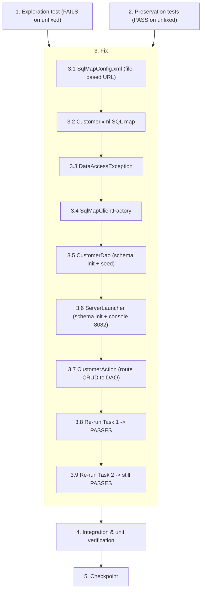

# Implementation Plan

## Overview

This plan delivers end-to-end H2 persistence for the customer data layer. It switches the iBATIS datasource to a file-based URL (`jdbc:h2:file:./data/yodadb;AUTO_SERVER=TRUE`) so data survives restarts, starts the H2 Web Console on port 8082 from `ServerLauncher`, and wires customer CRUD to the database through an iBATIS `Customer.xml` SQL map, a `SqlMapClientFactory` singleton, and a `CustomerDao` that handles schema initialization and conditional demo seeding. `CustomerAction` is rewired to route all CRUD through the DAO instead of the static in-memory list. The plan follows an exploration-test-first / preservation-test-first methodology: a bug-condition exploration test is written first and must FAIL on the unfixed code to confirm the defects, and preservation property tests are written first and must PASS on the unfixed code to lock in existing UI behavior and connectivity before the fix is applied.

## Tasks

- [ ] 1. Write bug condition exploration test
  - **Property 1: Bug Condition** - End-to-End H2 Persistence, Console, and Data Wiring
  - **CRITICAL**: This test MUST FAIL on unfixed code - failure confirms the bug exists
  - **DO NOT attempt to fix the test or the code when it fails**
  - **NOTE**: This test encodes the expected behavior - it will validate the fix when it passes after implementation
  - **GOAL**: Surface counterexamples that demonstrate all three defects (volatile in-memory datasource, no browser console, data layer never wired to H2)
  - **Scoped PBT Approach**: These defects are deterministic (config + startup wiring + static-list CRUD), so scope the property to the concrete failing cases below rather than generating random inputs
  - Encode the bug condition from the design: `isBugCondition(X)` holds when `X.isRestartAfterDataWrite = true` OR `X.requiresBrowserDbAccess = true` OR `X.isCustomerWriteExpectedToPersist = true`
  - **(a) Persistent datasource assertion**: parse `src/main/resources/SqlMapConfig.xml` and assert `JDBC.ConnectionURL` begins with `jdbc:h2:file:` and contains `AUTO_SERVER=TRUE` (on unfixed code the URL is `jdbc:h2:mem:yodadb;DB_CLOSE_DELAY=-1`, so this assertion FAILS)
  - **(b) Console reachability assertion**: attempt an HTTP/socket connection to `http://localhost:8082` while `ServerLauncher` is running and assert it responds with the H2 Web Console page (on unfixed code the connection is refused because no `createWebServer` call exists, so this assertion FAILS)
  - **(c) End-to-end data-wiring assertion**: assert the `CUSTOMER` table exists and that a customer added via the `CustomerDao`/`CustomerAction` write path is read back from the database through the `SqlMapClient` (on unfixed code there is no `Customer.xml`, no `SqlMapClient` bootstrap, no `CUSTOMER` table, and CRUD runs against a static `CopyOnWriteArrayList`, so this assertion FAILS)
  - The test assertions match the Expected Behavior from design Properties 1, 2, and 3 and the `expectedBehavior(result)` spec: `configuredUrl` starts with `jdbc:h2:file:`, console reachable at `http://localhost:8082`, `customerTableExists = true`, `writeExecutedVia = "SqlMapClient"`, and `rowPresentInDbAfterUiAction = true`
  - Run test on UNFIXED code
  - **EXPECTED OUTCOME**: Test FAILS (this is correct - it proves the bug exists)
  - Document counterexamples found (e.g., "configured URL uses the volatile `jdbc:h2:mem:` scheme"; "port 8082 connection refused - no H2 Web Console started"; "`CUSTOMER` table does not exist and the added row lives only in the static list")
  - Mark task complete when test is written, run, and failure is documented
  - _Requirements: 1.1, 1.2, 1.3, 1.4, 1.5, 1.6, 2.1, 2.2, 2.3, 2.4, 2.5, 2.6, 2.7, 2.8, 2.9, 2.10, 2.11_

- [ ] 2. Write preservation property tests (BEFORE implementing fix)
  - **Property 2: Preservation** - Existing UI Behavior and Connectivity
  - **IMPORTANT**: Follow observation-first methodology - run the UNFIXED code first, record actual outputs, then assert those outputs
  - Observe on UNFIXED code: `SqlMapConfig.xml` declares driver `org.h2.Driver`, username `sa`, and empty password
  - Observe on UNFIXED code: `http://localhost:8080/struts1-app/welcome.do` returns 200
  - Observe on UNFIXED code: the `Customer` model fields are `id`, `name`, `email`, `phone`, `city` and the class is `Serializable`
  - Observe on UNFIXED code: same-session UI CRUD (add/edit/delete) produces given final list state, the same `CustomerForm.validateFields()` validation errors (`errors.required`, `errors.email`), and the same success messages (`customer.success.added`, `customer.success.deleted`)
  - Write config preservation assertions: driver = `org.h2.Driver`, user = `sa`, password = empty (preserves Req 3.1)
  - Write Tomcat endpoint assertion: fixed app still serves `http://localhost:8080/struts1-app/welcome.do` with the same 200 response at `/struts1-app` (preserves Req 3.2)
  - Write model preservation assertions: `Customer` keeps fields `id`, `name`, `email`, `phone`, `city` and remains `Serializable` (preserves Req 3.7)
  - Write UI-behavior property test: over a sequence of random same-session customer operations (add/edit/delete in random order, including invalid inputs), assert the UI-observable results are equivalent between unfixed and fixed builds - the resulting rendered customer list state, the validation errors raised, and the success messages shown must match (preserves Req 3.3, 3.4, 3.5, 3.6). Because the fix replaces the static list with DB-backed CRUD, preservation is asserted on UI-observable results, not on the internal list object
  - Run tests on UNFIXED code
  - **EXPECTED OUTCOME**: Tests PASS (this confirms the baseline behavior to preserve)
  - Mark task complete when tests are written, run, and passing on unfixed code
  - _Requirements: 3.1, 3.2, 3.3, 3.4, 3.5, 3.6, 3.7_

- [x] 3. Fix for end-to-end H2 persistence, Web Console, and customer data wiring

  - [x] 3.1 Switch the iBATIS datasource to a persistent file-based URL
    - Edit `src/main/resources/SqlMapConfig.xml` only (do NOT edit the `target/` copies; Maven re-copies on the next build)
    - Replace the `JDBC.ConnectionURL` value `jdbc:h2:mem:yodadb;DB_CLOSE_DELAY=-1` with `jdbc:h2:file:./data/yodadb;AUTO_SERVER=TRUE`
    - Leave driver `org.h2.Driver`, username `sa`, and the empty password exactly as-is
    - Leave the `<sqlMap resource="Customer.xml"/>` declaration and the rest of the file structure unchanged - it now resolves to a real file
    - _Bug_Condition: isBugCondition(X) where X.isRestartAfterDataWrite = true (in-memory URL) from design_
    - _Expected_Behavior: configuredUrl STARTS WITH "jdbc:h2:file:" and contains AUTO_SERVER=TRUE from design Property 1 / expectedBehavior spec_
    - _Preservation: driver `org.h2.Driver`, user `sa`, empty password unchanged (Preservation Requirement 3.1)_
    - _Requirements: 2.1, 2.2, 3.1_

  - [x] 3.2 Create the iBATIS Customer SQL map
    - Create new file `src/main/resources/Customer.xml` so it lands on the classpath at `target/classes/Customer.xml` and resolves via the existing `<sqlMap resource="Customer.xml"/>` declaration
    - Use the iBATIS SQL Map 2.0 DTD, namespace `Customer`
    - Define `resultMap` `customerResult` over `com.example.struts.model.Customer` mapping columns `id`, `name`, `email`, `phone`, `city` to the matching model properties
    - Statements: `selectAllCustomers` (`SELECT ... FROM CUSTOMER ORDER BY id`), `selectCustomerById` (`parameterClass="java.lang.String"`, `WHERE id = #value#`), `insertCustomer` (`parameterClass` Customer), `updateCustomer` (`parameterClass` Customer, `WHERE id = #id#`), `deleteCustomer` (`parameterClass="java.lang.String"`, `WHERE id = #value#`)
    - Do NOT put any `CREATE TABLE` DDL in the map; DDL is handled in Java (see 3.5)
    - _Bug_Condition: isBugCondition(X) where X.isCustomerWriteExpectedToPersist = true (Customer.xml missing) from design_
    - _Expected_Behavior: writeExecutedVia = "SqlMapClient" against the CUSTOMER table from design Property 3 / expectedBehavior spec_
    - _Requirements: 2.7, 2.8, 2.9, 2.10_

  - [x] 3.3 Add the unchecked DataAccessException wrapper
    - Create new file `src/main/java/com/example/struts/db/DataAccessException.java`
    - Make it a `public class DataAccessException extends RuntimeException` with a `(String message, Throwable cause)` constructor delegating to `super`
    - This keeps `CustomerAction`'s signature unchanged by converting the checked iBATIS `SQLException` into an unchecked exception
    - _Bug_Condition: isBugCondition(X) where X.isCustomerWriteExpectedToPersist = true from design_
    - _Expected_Behavior: DAO errors surface as unchecked DataAccessException per design Error Handling_
    - _Preservation: CustomerAction keeps its existing `throws Exception` signature (Preservation Requirement 3.3)_
    - _Requirements: 2.7_

  - [x] 3.4 Add the SqlMapClient singleton factory
    - Create new file `src/main/java/com/example/struts/db/SqlMapClientFactory.java`
    - Build exactly one `SqlMapClient` using `com.ibatis.common.resources.Resources.getResourceAsReader("SqlMapConfig.xml")` + `com.ibatis.sqlmap.client.SqlMapClientBuilder.buildSqlMapClient(reader)`
    - Use a `private static volatile SqlMapClient instance` with double-checked locking in `getSqlMapClient()`; private constructor
    - Wrap any build/read failure in a `RuntimeException` so a misconfigured bootstrap fails fast and loudly
    - Use the confirmed `com.ibatis.*` packages (the `org.apache.ibatis:ibatis-sqlmap:2.3.4.726` jar repackages classic iBATIS 2.3.4 under `com.ibatis.*`)
    - _Bug_Condition: isBugCondition(X) where X.isCustomerWriteExpectedToPersist = true (no SqlMapClient bootstrap) from design_
    - _Expected_Behavior: writeExecutedVia = "SqlMapClient" from design Property 3 / expectedBehavior spec_
    - _Requirements: 2.7_

  - [x] 3.5 Add the CustomerDao with schema init, conditional seed, and collision-safe id generation
    - Create new file `src/main/java/com/example/struts/db/CustomerDao.java`
    - Hold `private final SqlMapClient sqlMap = SqlMapClientFactory.getSqlMapClient();`
    - Implement `list()`, `findById(id)`, `insert(c)`, `update(c)`, `delete(id)` using the mapped statements; each catches `java.sql.SQLException` and rethrows `DataAccessException`
    - Implement `initSchemaAndSeed()`: run `CREATE TABLE IF NOT EXISTS CUSTOMER (id VARCHAR PRIMARY KEY, name, email, phone, city)` via `sqlMap.getDataSource().getConnection()` + a JDBC `Statement` (idempotent so restarts never fail); then seed exactly `CUST-001` Budi Santoso budi@example.com 08123456789 Jakarta and `CUST-002` Siti Aminah siti@example.com 08234567890 Surabaya ONLY when `list().isEmpty()`
    - Implement `nextId()` as `CUST-%03d` from `max(existing numeric suffix) + 1` (collision-safe after deletes), skipping non-conforming ids
    - _Bug_Condition: isBugCondition(X) where X.isCustomerWriteExpectedToPersist = true (no CUSTOMER table, no DB-backed CRUD) from design_
    - _Expected_Behavior: customerTableExists = true, demo rows seeded only when table empty, demoRowsReseeded = false otherwise, generatedIdCollides = false from design Property 3 / expectedBehavior spec_
    - _Requirements: 2.5, 2.6, 2.7, 2.8, 2.9, 2.10, 2.11_

  - [x] 3.6 Initialize schema and start the H2 Web Console in ServerLauncher
    - Edit `src/main/java/com/example/struts/ServerLauncher.java`, method `main(String[] args)`
    - BEFORE `tomcat.start()`: call `new com.example.struts.db.CustomerDao().initSchemaAndSeed();` so the table and demo data exist before any request can arrive (this first embedded connection, with `AUTO_SERVER=TRUE`, starts the shared server the console attaches to)
    - Start the console: `org.h2.tools.Server webConsole = org.h2.tools.Server.createWebServer("-webPort", "8082").start();` and log the console URL `http://localhost:8082`
    - Register a JVM shutdown hook `Runtime.getRuntime().addShutdownHook(new Thread(webConsole::stop));` so port 8082 is released cleanly on exit
    - Ordering: seed the DB and start the console, then start Tomcat, so the app never serves a request against a missing table
    - Do NOT change the Tomcat port, context path `/struts1-app`, connector setup, or the existing `tomcat.getServer().await()` blocking call (port 8080 stays as-is)
    - _Bug_Condition: isBugCondition(X) where X.requiresBrowserDbAccess = true (no console) OR X.isCustomerWriteExpectedToPersist = true (no schema init) from design_
    - _Expected_Behavior: consoleReachableAt = "http://localhost:8082" AND customerTableExists = true from design Properties 2, 3 / expectedBehavior spec_
    - _Preservation: embedded Tomcat on port 8080 at /struts1-app unchanged (Preservation Requirement 3.2)_
    - _Requirements: 2.3, 2.4, 2.5, 2.6, 3.2_

  - [x] 3.7 Rewrite CustomerAction to route all CRUD through the DAO
    - Edit `src/main/java/com/example/struts/action/CustomerAction.java`
    - Remove the static `CopyOnWriteArrayList<Customer> CUSTOMERS` field, the `static {}` seed block, and the `CopyOnWriteArrayList`/`UUID` imports
    - Add `private final CustomerDao dao = new CustomerDao();`
    - `save`/`add`: still call `customerForm.validateFields()` (unchanged); on validation errors, `saveErrors`, set `request.setAttribute("customerList", dao.list())`, and `findForward("list")`. If `id` is present and non-blank -> `dao.update(new Customer(...))`; else -> `String newId = dao.nextId();` then `dao.insert(new Customer(newId, ...))`. Still add the `customer.success.added` message, `saveMessages`, and reset the form
    - `delete`: read `request.getParameter("id")`; if non-null call `dao.delete(id)` and add `customer.success.deleted`
    - `edit`: read `request.getParameter("id")`; if non-null call `Customer c = dao.findById(id)` and, when found, copy its fields onto the form
    - End of `execute`: `request.setAttribute("customerList", dao.list());` then `return mapping.findForward("list");`
    - Keep the existing `throws Exception` signature; DAO errors arrive as unchecked `DataAccessException`
    - _Bug_Condition: isBugCondition(X) where X.isCustomerWriteExpectedToPersist = true (CRUD against static list) from design_
    - _Expected_Behavior: rowPresentInDbAfterUiAction = true, writeExecutedVia = "SqlMapClient" from design Property 3 / expectedBehavior spec_
    - _Preservation: same actions/list forward, validateFields() errors, success messages, form reset, and `customerList` attribute (Preservation Requirements 3.3, 3.4, 3.5, 3.6)_
    - _Requirements: 2.7, 2.8, 2.9, 2.10, 2.11, 3.3, 3.4, 3.5, 3.6_

  - [ ] 3.8 Verify bug condition exploration test now passes
    - **Property 1: Expected Behavior** - End-to-End H2 Persistence, Console, and Data Wiring
    - **IMPORTANT**: Re-run the SAME test from task 1 - do NOT write a new test
    - The test from task 1 encodes the expected behavior; when it passes, it confirms the expected behavior is satisfied
    - Confirm (a) the config assertion now passes (URL uses `jdbc:h2:file:` and contains `AUTO_SERVER=TRUE`)
    - Confirm (b) the console at `http://localhost:8082` is now reachable and connects to the same persistent file DB with user `sa` and empty password
    - Confirm (c) the `CUSTOMER` table exists and a customer added through the DAO/action is read back from the DB via the `SqlMapClient`
    - **EXPECTED OUTCOME**: Test PASSES (confirms bug is fixed)
    - _Requirements: 2.1, 2.2, 2.3, 2.4, 2.5, 2.6, 2.7, 2.8, 2.9, 2.10, 2.11_

  - [ ] 3.9 Verify preservation tests still pass
    - **Property 2: Preservation** - Existing UI Behavior and Connectivity
    - **IMPORTANT**: Re-run the SAME tests from task 2 - do NOT write new tests
    - Confirm driver `org.h2.Driver`, user `sa`, and empty password are unchanged
    - Confirm `http://localhost:8080/struts1-app/welcome.do` still returns 200 at `/struts1-app`
    - Confirm the `Customer` model fields (`id`, `name`, `email`, `phone`, `city`) and `Serializable` are unchanged
    - Confirm UI-observable CRUD results, `validateFields()` errors, and success messages (`customer.success.added`, `customer.success.deleted`) are equivalent before and after the fix
    - **EXPECTED OUTCOME**: Tests PASS (confirms no regressions)
    - _Requirements: 3.1, 3.2, 3.3, 3.4, 3.5, 3.6, 3.7_

- [ ] 4. Integration and unit verification - persistence, console, CRUD round-trip, and clean shutdown
  - **Map/client build**: `Customer.xml` parses and the `SqlMapClient` builds successfully from `SqlMapConfig.xml` via `SqlMapClientFactory`
  - **DAO CRUD round-trip**: against a test H2 database, exercise `insert` -> `findById` -> `list` -> `update` -> `delete` and confirm each result round-trips through the `SqlMapClient`
  - **nextId collision-safety**: with rows `CUST-001`, `CUST-002`, `CUST-003`, delete `CUST-002`, then confirm `nextId()` returns `CUST-004` (not a colliding `CUST-003`)
  - **initSchemaAndSeed idempotency**: run it twice; confirm the schema creation does not fail and the two demo rows are NOT re-seeded or duplicated when the table is already populated
  - **Boot ServerLauncher**: GET `http://localhost:8080/struts1-app/welcome.do` returns 200 (Tomcat preserved); GET `http://localhost:8082` returns the H2 Web Console page (console reachable)
  - **Persistence across restart**: add a customer via the action/DAO, simulate a restart by building a fresh `SqlMapClient` against the same file DB, and confirm the row still persists in `data/yodadb.mv.db`
  - **No re-seed when populated**: confirm the two demo rows are not re-seeded on a restart where the table already contains data
  - **Clean shutdown**: stop the JVM and confirm the shutdown hook releases port 8082
  - _Requirements: 2.1, 2.2, 2.3, 2.4, 2.5, 2.6, 2.7, 2.8, 2.9, 2.10, 2.11, 3.2_

- [ ] 5. Checkpoint - Ensure all tests pass
  - Ensure all unit, property-based, and integration tests pass, and ask the user if questions arise

## Task Dependency Graph

Tasks 1 and 2 are written and run against the UNFIXED code before any fix begins: Task 1 (exploration test) must FAIL first, and Task 2 (preservation tests) must PASS first. Both must be complete before Task 3. Within Task 3 the build order is strictly sequential (3.1 -> 3.2 -> 3.3 -> 3.4 -> 3.5 -> 3.6 -> 3.7), after which the two verification sub-tasks re-run the earlier tests (3.8 re-runs Task 1 and it now PASSES; 3.9 re-runs Task 2 and it still PASSES). Task 4 (integration/unit verification) depends on Task 3, and Task 5 (checkpoint) depends on Task 4.



```json
{
  "waves": [
    { "wave": 1, "tasks": ["1", "2"], "dependsOn": [] },
    { "wave": 2, "tasks": ["3.1"], "dependsOn": ["1", "2"] },
    { "wave": 3, "tasks": ["3.2"], "dependsOn": ["3.1"] },
    { "wave": 4, "tasks": ["3.3"], "dependsOn": ["3.2"] },
    { "wave": 5, "tasks": ["3.4"], "dependsOn": ["3.3"] },
    { "wave": 6, "tasks": ["3.5"], "dependsOn": ["3.4"] },
    { "wave": 7, "tasks": ["3.6"], "dependsOn": ["3.5"] },
    { "wave": 8, "tasks": ["3.7"], "dependsOn": ["3.6"] },
    { "wave": 9, "tasks": ["3.8"], "dependsOn": ["3.7"] },
    { "wave": 10, "tasks": ["3.9"], "dependsOn": ["3.8"] },
    { "wave": 11, "tasks": ["4"], "dependsOn": ["3.9"] },
    { "wave": 12, "tasks": ["5"], "dependsOn": ["4"] }
  ]
}
```

## Notes

- The `target/` directory holds build artifacts that Maven re-copies on each build (e.g. `target/classes/SqlMapConfig.xml`); edit sources under `src/` only, never the `target/` copies.
- iBATIS version `2.3.4.726` repackages classic iBATIS under the `com.ibatis.*` package namespace (e.g. `com.ibatis.common.resources.Resources`, `com.ibatis.sqlmap.client.SqlMapClientBuilder`).
- The persistent database lives at `./data/yodadb.mv.db`, outside `target/`, so customer data survives restarts and Maven rebuilds.
- A known `nextId()` concurrency edge (concurrent inserts could compute the same next id) is documented in the design; it is accepted for this single-node demo scope.
